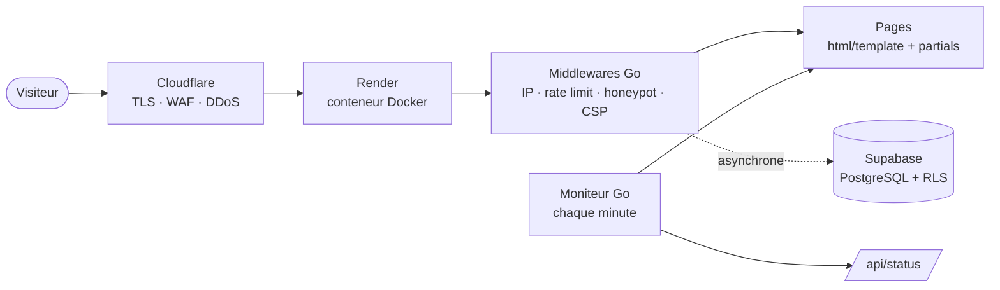

# orlandocogo.com

[](https://github.com/cogo-orlando/portfolio/actions/workflows/ci.yml)


Portfolio d'**Orlando Cogo**, étudiant en Bachelor Informatique (spécialisation **cybersécurité**) à Ynov Campus Toulouse.

**🌐 [orlandocogo.com](https://orlandocogo.com)**

Ce n'est pas un simple site vitrine : c'est un **serveur Go écrit sans framework**, déployé en production, avec une chaîne de livraison et des protections que j'ai construites et testées moi-même. Le site sert à la fois de portfolio et de terrain d'entraînement en sécurité applicative et en DevOps.

---

## Sommaire

- [Architecture](#architecture)
- [Sécurité](#sécurité)
- [Chaîne de livraison (CI/CD)](#chaîne-de-livraison-cicd)
- [Structure du projet](#structure-du-projet)
- [Lancer le projet](#lancer-le-projet)
- [Choix techniques](#choix-techniques)
- [Ce que j'ai appris](#ce-que-jai-appris)
- [Signaler une faille](#signaler-une-faille)

---

## Architecture



| Couche | Technologie |
|---|---|
| Backend | **Go 1.27**, bibliothèque standard uniquement (`net/http`, `html/template`, `log/slog`) |
| Frontend | HTML, CSS et JavaScript vanilla · design glassmorphism · polices hébergées sur le site |
| Conteneur | Docker multi-stage → image `scratch` (binaire statique, non-root) |
| Hébergement | Render (déploiement uniquement si la CI est verte) |
| Réseau | Cloudflare (DNS, TLS, WAF, protection DDoS) |
| Base de données | Supabase PostgreSQL (logs de sécurité, Row Level Security) |
| Dépendances Go | **une seule** : `github.com/lib/pq` |

---

## Sécurité

### Côté serveur
- **IP réelle non falsifiable** : l'en-tête `CF-Connecting-IP` n'est accepté que si la requête arrive réellement d'un serveur Cloudflare (vérification des plages d'IP officielles). Un attaquant qui appelle directement l'origine ne peut plus usurper une IP pour contourner le rate limit ou faire bloquer quelqu'un d'autre. Les tests reproduisent l'attaque.
- **Accès direct à l'origine bloquable** (`REQUIRE_CLOUDFLARE=true`) : le WAF de Cloudflare ne peut pas être contourné.
- **Rate limiting** : 120 requêtes par minute et par IP, avec `Retry-After`.
- **Honeypot** : 15 routes pièges (`/wp-admin`, `/.env`, `/.git/config`…) qui blacklistent l'IP pendant 24 h.
- **Content-Security-Policy stricte** : `script-src 'self'`, aucun script inline, pas d'`eval`, `frame-ancestors 'none'`, `object-src 'none'`.
- **En-têtes de durcissement** : `nosniff`, `Referrer-Policy`, `Permissions-Policy`, en-tête `Server` masqué.
- **Panic recovery** : aucune stack trace n'est jamais renvoyée au visiteur (vérifié par test).
- **Timeouts** par route et `ReadHeaderTimeout` (protection Slowloris), pas de listing de dossiers.

### Données et vie privée
- **IP des visiteurs anonymisées** avant stockage (`203.0.113.42` → `203.0.113.0`). Seules les IP des attaques (honeypot, rate limit) sont conservées complètes.
- **Rétention de 30 jours** avec purge automatique.
- **File d'attente bornée** et écriture par lots : un flood de requêtes ne peut pas saturer le serveur ni la base.
- **Requêtes SQL 100 % paramétrées** (injection testée), connexion TLS obligatoire, Row Level Security sans policy publique.
- **Aucun service tiers côté visiteur** : polices hébergées sur le site (plus de Google Fonts).

### Conteneur
- Image `scratch` : ni shell, ni gestionnaire de paquets, ni outils exploitables.
- Utilisateur non-root, fichiers en lecture seule pour le processus.
- `read_only`, `cap_drop: ALL`, `no-new-privileges`.
- Healthcheck intégré au binaire (port validé : alerte SSRF de gosec corrigée à la source).

---

## Chaîne de livraison (CI/CD)

Chaque modification passe par **quatre niveaux de contrôle** avant d'arriver en production :

```
commit ──► hook pre-commit ──► push ──► CI GitHub Actions ──► Render
           gofmt · vet · tests          (si tout est vert)
```

| Étape | Vérifie |
|---|---|
| `gofmt` · `go vet` | Formatage et erreurs courantes |
| `go test -race` | Tous les packages, avec le détecteur de concurrence et la couverture |
| Test de rendu | **Chaque page HTML** est générée : un template cassé ou un fichier manquant bloque le déploiement |
| `govulncheck` | Vulnérabilités connues de Go et des dépendances réellement appelées par le code |
| `gosec` | Analyse de sécurité statique du code |
| Image Docker | Le build réussit et le conteneur démarre `healthy` avec le durcissement de production |

En plus :
- **Scan hebdomadaire** (chaque lundi), même sans push, pour détecter les failles publiées entre-temps.
- **Dependabot** propose chaque semaine les mises à jour de Go, de l'image Docker et des actions GitHub ; chaque proposition est testée par la CI.
- **Outils épinglés**, permissions GitHub en lecture seule, aucun secret de production exposé à la CI.

---

## Structure du projet

```
portfolio/
├── main.go                    # Point d'entrée · commande "healthcheck" pour Docker
├── server/
│   ├── server.go              # Routeur, /health, sitemap, arrêt gracieux
│   ├── handler/               # Rendu des templates, cache-busting {{asset}}, ETag
│   ├── middleware/            # IP réelle, rate limit, honeypot, CSP, gzip, cache, logs
│   ├── monitor/               # Vérifie chaque page toutes les minutes → /api/status
│   └── db/                    # Logs de sécurité : file bornée, anonymisation, rétention
├── web/
│   ├── html/                  # Pages + partials (head, nav, footer, données centralisées)
│   ├── css/                   # Design glass, tokens dans nav.css
│   ├── js/                    # core.js (outils partagés) + un script par page
│   ├── fonts/                 # Syne et DM Mono (woff2, licence OFL)
│   └── .well-known/           # security.txt (RFC 9116)
├── .github/                   # CI (ci.yml) et Dependabot
├── .githooks/pre-commit       # Vérifications locales avant chaque commit
└── Dockerfile                 # Build multi-stage → scratch
```

---

## Lancer le projet

### Prérequis
- Go **1.27** ou plus récent
- Docker (facultatif)

### En local
```bash
git clone https://github.com/cogo-orlando/portfolio.git
cd portfolio
git config core.hooksPath .githooks   # active les vérifications avant commit

# Mode développement : templates rechargés à chaque requête
GO_ENV=development go run main.go
# PowerShell : $env:GO_ENV="development"; go run main.go
```
Le site est disponible sur http://localhost:8080.

### Avec Docker
```bash
docker compose up -d --build   # image de production, durcie
docker compose -f docker-compose.dev.yml up --build   # dev avec hot reload
```

### Tests
```bash
gofmt -l . ; go vet ./... ; go test -count=1 ./...
```

### Variables d'environnement
| Variable | Rôle | Défaut |
|---|---|---|
| `PORT` | Port d'écoute | `8080` |
| `GO_ENV` | `development` : rechargement des templates | production |
| `DATABASE_URL` | Connexion PostgreSQL (logs désactivés si absente) | — |
| `LOG_RETENTION_DAYS` | Durée de conservation des logs | `30` |
| `REQUIRE_CLOUDFLARE` | `true` : refuse les accès qui ne passent pas par Cloudflare | désactivé |

---

## Choix techniques

- **Pas de framework web** : la bibliothèque standard de Go suffit, et c'est la meilleure façon de comprendre ce qu'un framework fait à notre place (routing, middlewares, timeouts, arrêt gracieux).
- **Templates Go + partials** : la navigation, le pied de page et tous les chiffres du site sont définis une seule fois. Un test garantit que chaque page s'affiche.
- **Cache-busting automatique** : `{{asset "/css/nav.css"}}` produit `/css/nav.css?v=<hash>`. Les fichiers sont mis en cache un an et rechargés automatiquement dès qu'ils changent.
- **Logs asynchrones et non bloquants** : la base de données ne peut jamais ralentir ni faire tomber le site.
- **JavaScript sans dépendance** : un `core.js` partagé (apparition au scroll, fetch avec timeout, échappement HTML…) et un script par page, sans script inline.

---

## Ce que j'ai appris

- **Une vulnérabilité se reproduit avant de se corriger.** Pour la faille `CF-Connecting-IP`, j'ai d'abord écrit les tests qui simulent l'attaque, puis corrigé le code jusqu'à ce qu'ils passent.
- **Un code sûr aujourd'hui ne l'est plus demain.** En ajoutant `govulncheck`, ma CI a découvert que la production tournait sur une version de Go qui n'était plus maintenue, avec des dizaines de failles connues. Le déploiement a été bloqué jusqu'à la mise à jour. Depuis, scans hebdomadaires et Dependabot.
- **Une alerte se traite à la source.** Quand `gosec` a signalé un risque de SSRF dans le healthcheck, j'ai validé l'entrée plutôt que de masquer l'alerte, puis documenté pourquoi le reste était sûr.
- **Sécurité et vie privée vont ensemble.** Stocker chaque visiteur « au cas où », c'est accumuler des données personnelles sans raison : anonymisation et durée de conservation limitée.

---

## Signaler une faille

Tu as trouvé un problème de sécurité ? Merci de me contacter avant toute publication : voir [`security.txt`](https://orlandocogo.com/.well-known/security.txt). Les signalements de bonne foi sont les bienvenus, réponse sous 72 h.

---

## Contact

- 🌐 [orlandocogo.com](https://orlandocogo.com)
- ✉️ [Orlando.cogo.pro@gmail.com](mailto:Orlando.cogo.pro@gmail.com)
- 💼 [LinkedIn](https://www.linkedin.com/in/TON-PROFIL)  <!-- remplace par ton vrai lien -->

Polices : [Syne](https://gitlab.com/bonjour-monde/fonderie/syne-typeface) et [DM Mono](https://github.com/googlefonts/dm-mono), sous licence SIL Open Font License 1.1.
